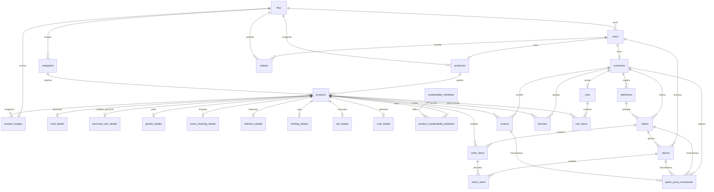

# BuenOrigen Backend


**API REST desarrollada con NestJS y TypeScript para la plataforma de comercio electrónico BuenOrigen.**

## Descripción

**BuenOrigen** es una plataforma de comercio electrónico orientada a la comercialización de productos sustentables de distintos emprendedores.

Este repositorio contiene el Backend de la plataforma, encargado de gestionar los datos, aplicar las reglas de negocio y proporcionar los servicios necesarios para las aplicaciones Web y Mobile.

El proyecto utiliza PostgreSQL y TypeORM para la persistencia de información, autenticación mediante JWT y documentación de servicios mediante Swagger / OpenAPI.

## Tecnologías utilizadas

- Node.js 22
- TypeScript
- NestJS 11
- PostgreSQL 18.6
- TypeORM
- JWT
- Swagger / OpenAPI
- Docker y Docker Compose
- Jest

## Funcionalidades principales

El Backend incorpora servicios para las siguientes funcionalidades:

| Módulo | Descripción |
|---|---|
| Autenticación | Inicio de sesión y autenticación mediante JWT. |
| Clientes | Registro, consulta y actualización de información de clientes. |
| Productos | Catálogo, búsqueda, filtros y administración de productos. |
| Categorías | Organización de productos por categorías. |
| Productores | Gestión de información y productos de emprendedores. |
| Carrito | Administración de productos seleccionados para comprar. |
| Checkout | Validación del carrito y generación de pedidos. |
| Pedidos | Consulta y gestión de pedidos según los permisos del usuario. |
| Devoluciones | Solicitudes y administración de devoluciones. |
| Valoraciones | Registro y consulta de opiniones sobre productos. |
| Favoritos | Administración de productos favoritos. |
| Direcciones | Gestión de direcciones de clientes. |
| Artículos | Consulta y administración de contenidos. |
| Archivos | Almacenamiento y consulta de imágenes. |

La API incorpora validaciones de entrada, manejo de errores HTTP y autorización según los roles definidos para la aplicación.

### Puntos Verdes y sustentabilidad

BuenOrigen contempla un sistema de beneficios asociado a la compra de productos sustentables.

Entre las principales reglas de negocio se encuentran:

- Asignación de 80 Puntos Verdes de bienvenida.
- Acumulación de 100 Puntos Verdes por kilogramo de CO₂e evitado, acreditados cuando el pedido se encuentra entregado.
- Equivalencia de 1 Punto Verde a $1 CLP.
- Canje máximo del 20 % del subtotal elegible.
- Consulta de información de sustentabilidad de los productos.

## Requisitos

Para ejecutar el proyecto se requiere:

- Node.js 22 y npm.
- Git.
- PostgreSQL 18.6 para ejecución local.
- Docker y Docker Compose para ejecución mediante contenedores.

## Instalación

Clonar el repositorio:

```bash
git clone https://github.com/bootcamp-uchile-2026/grupo-2-backend.git
cd grupo-2-backend
```

Instalar las dependencias:

```bash
npm install
```

## Configuración

El repositorio incluye un archivo `.env.example` con las variables de entorno necesarias.

Crear el archivo `.env`:

```bash
cp .env.example .env
```

Configurar las variables correspondientes a PostgreSQL, JWT y almacenamiento de archivos.

| Variable | Descripción |
|---|---|
| `PORT` | Puerto de la aplicación. |
| `DB_HOST` | Servidor de PostgreSQL. |
| `DB_PORT` | Puerto de PostgreSQL. |
| `DB_USERNAME` | Usuario de la base de datos. |
| `DB_PASSWORD` | Contraseña de PostgreSQL. |
| `DB_DATABASE` | Nombre de la base de datos. |
| `JWT_SECRET` | Clave utilizada para firmar los tokens JWT. |
| `JWT_EXPIRES_IN` | Tiempo de expiración del token. |
| `BASE_ARCHIVOS` | Directorio de almacenamiento de archivos. |

**Importante:** no publicar archivos `.env` ni credenciales reales en GitHub.

## Ejecución local

Con PostgreSQL disponible y las variables de entorno configuradas, iniciar el servidor:

```bash
npm run start:dev
```

La API estará disponible en:

http://localhost:3000

## Scripts disponibles

Los siguientes comandos están definidos en `package.json`.

### Desarrollo y compilación

| Comando | Descripción |
|---|---|
| `npm run start` | Inicia la aplicación. |
| `npm run start:dev` | Inicia el servidor en desarrollo con recarga automática. |
| `npm run start:debug` | Inicia la aplicación en modo depuración. |
| `npm run build` | Compila el proyecto. |
| `npm run start:prod` | Ejecuta la versión compilada. |

### Calidad y pruebas

| Comando | Descripción |
|---|---|
| `npm run format` | Aplica formato al código mediante Prettier. |
| `npm run lint` | Ejecuta ESLint con corrección automática. |
| `npm run test` | Ejecuta las pruebas unitarias. |
| `npm run test:watch` | Ejecuta las pruebas en modo observación. |
| `npm run test:cov` | Genera un reporte de cobertura. |
| `npm run test:e2e` | Ejecuta las pruebas end-to-end. |

### Base de datos y migraciones

| Comando | Descripción |
|---|---|
| `npm run migration:show` | Consulta el estado de las migraciones. |
| `npm run migration:run` | Ejecuta las migraciones pendientes. |
| `npm run migration:revert` | Revierte la última migración ejecutada. |
| `npm run migration:show:prod` | Consulta las migraciones de la versión compilada. |
| `npm run migration:run:prod` | Ejecuta las migraciones de la versión compilada. |
| `npm run migration:generate -- <ruta>` | Genera una migración a partir de cambios en las entidades. |

Los comandos de migraciones requieren una conexión válida con PostgreSQL. Los scripts de producción requieren los archivos compilados y la configuración correspondiente.

## Base de datos

BuenOrigen utiliza **PostgreSQL y TypeORM** para administrar las entidades, relaciones y persistencia de información.

El modelo de datos contempla usuarios, clientes, productores, productos, categorías, carritos, pedidos, devoluciones, valoraciones y otros componentes del comercio electrónico.

Las migraciones se encuentran en:

`src/database/migrations`

La versión `3.0.1` contiene 11 migraciones de TypeORM, incluyendo la creación de las tablas, la incorporación de datos iniciales y ajustes posteriores del modelo.

Para consultar el estado de las migraciones:

```bash
npm run migration:show
```

Para ejecutar las migraciones pendientes:

```bash
npm run migration:run
```

Antes de ejecutar las migraciones, PostgreSQL debe estar disponible y las variables de entorno deben estar configuradas.

La ejecución sobre una base de datos existente debe considerar la conservación de los datos almacenados.

## Modelo Entidad-Relación

El modelo de datos de BuenOrigen se encuentra implementado mediante entidades TypeORM y migraciones de PostgreSQL.

Las migraciones estructurales de la versión `3.0.1` contemplan **28 tablas**, organizadas para gestionar usuarios, productos, compras, devoluciones, valoraciones y sustentabilidad.

El siguiente diagrama Mermaid presenta una vista general de las tablas y sus principales relaciones, utilizando cardinalidades simplificadas para facilitar la lectura.



### Organización del modelo

El modelo permite:

- Relacionar usuarios con clientes y productores.
- Asociar productos a sus categorías y productores.
- Administrar carritos, pedidos y sus respectivos productos.
- Registrar solicitudes de devolución y valoraciones.
- Gestionar movimientos de Puntos Verdes.
- Asociar productos con características de sustentabilidad.
- Gestionar imágenes y archivos vinculados a los distintos registros.
- Almacenar información específica según el tipo de producto.

Las entidades se encuentran en `src/models` y las migraciones de la base de datos en `src/database/migrations`.

Para revisar los atributos, claves primarias, claves foráneas y restricciones exactas del modelo, se deben consultar las entidades y migraciones del repositorio.

## Ejecución con Docker

El proyecto incluye un `Dockerfile` y archivos Docker Compose para ejecutar los servicios.

### Iniciar los servicios

Desde la raíz del proyecto, con el archivo `.env` configurado:

```bash
docker compose up -d --build
```

Este comando construye la imagen local del Backend e inicia PostgreSQL y la API.

### Revisar los contenedores

```bash
docker compose ps
```

### Consultar los registros

```bash
docker compose logs -f backend
```

### Detener los servicios

```bash
docker compose down
```

La configuración utiliza un volumen para conservar los datos de PostgreSQL y un directorio para almacenar archivos.

Las migraciones de TypeORM deben ejecutarse por separado, utilizando el procedimiento correspondiente al entorno configurado.

## Swagger / OpenAPI

La API utiliza Swagger para documentar sus endpoints, parámetros, DTO, mecanismos de autenticación y respuestas HTTP.

Con el Backend ejecutándose localmente:

- **Swagger UI:** http://localhost:3000/api
- **OpenAPI JSON:** http://localhost:3000/api-json

Desde Swagger es posible consultar los servicios disponibles y probar las operaciones de la API.

Para utilizar endpoints protegidos se requiere autenticación JWT y los permisos correspondientes.

## Versionado y Docker Hub

El proyecto utiliza versionado semántico para identificar sus versiones estables.

### Versión Hito 3

| Elemento | Referencia |
|---|---|
| Versión de la aplicación | `3.0.1` |
| Tag Git | `v3.0.1` |
| Commit de entrega | `ff7e7ecc18e2b4a9dce57fc59b6f97272ce50749` |
| Imagen Docker | `sebackend/ecotienda-backend:v3.0.1` |

La imagen versionada está publicada en Docker Hub.

Para descargarla:

```bash
docker pull sebackend/ecotienda-backend:v3.0.1
```

El repositorio incluye el archivo `docker-compose.oracle.yml` para configurar el despliegue en servidor mediante la imagen publicada.

La configuración del entorno, PostgreSQL y las migraciones deben verificarse antes de iniciar la aplicación.

## Documentación técnica

La documentación complementaria se encuentra disponible en la Wiki del repositorio:

[Wiki de BuenOrigen Backend](https://github.com/bootcamp-uchile-2026/grupo-2-backend/wiki)

La Wiki contiene información sobre la implementación, configuración, funcionalidades y decisiones técnicas del proyecto.

Los contratos HTTP y las operaciones disponibles se documentan mediante Swagger / OpenAPI.

## Equipo

Proyecto desarrollado por el equipo **BuenOrigen**, en el marco del Bootcamp de Desarrollo Backend del Departamento de Ciencias de la Computación de la Universidad de Chile.

**Repositorio:** https://github.com/bootcamp-uchile-2026/grupo-2-backend
