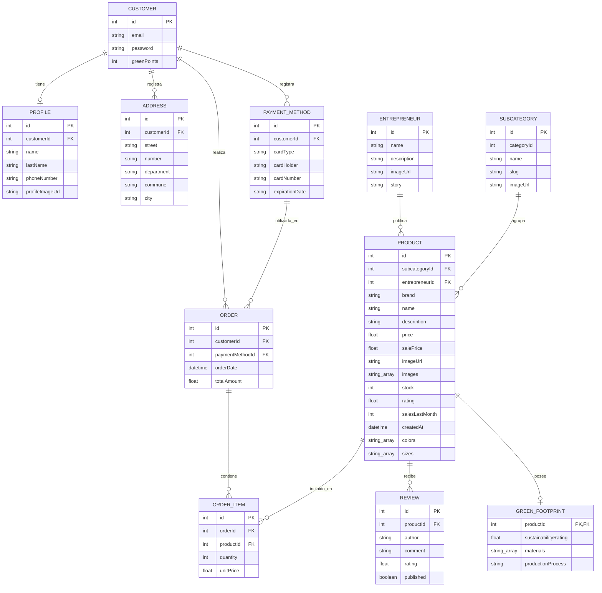
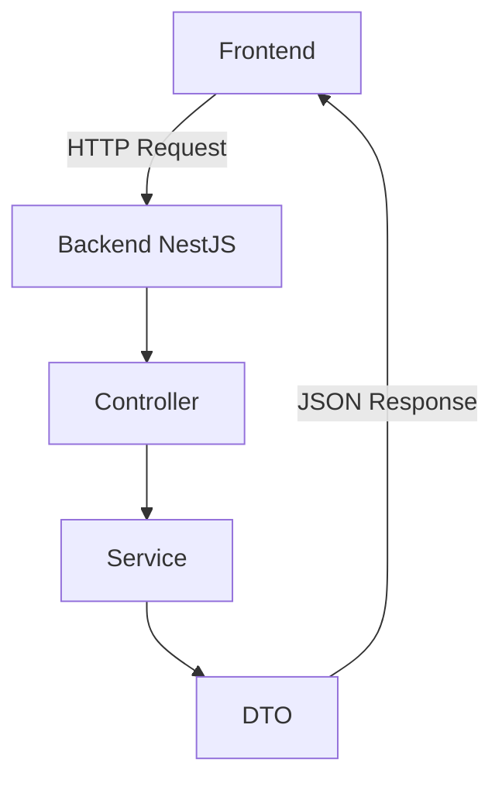
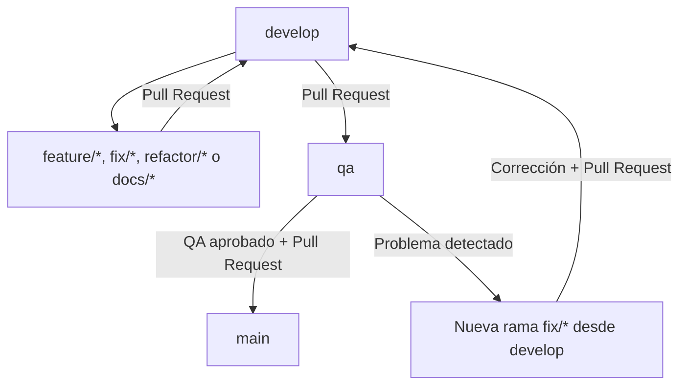

<p align="center">
  
</p>

<h1 align="center">BuenOrigen Backend</h1>

<p align="center">
  API REST desarrollada con NestJS para la plataforma e-commerce BuenOrigen.
</p>

---

## Descripción

**BuenOrigen** es una plataforma e-commerce orientada a la comercialización de productos sustentables ofrecidos por distintos emprendedores.

Este repositorio contiene el **Backend** de la aplicación, desarrollado utilizando **NestJS y TypeScript**.

El Backend proporciona una API REST que permitirá la integración con las aplicaciones Frontend y Mobile.

---

## Tecnologías utilizadas

- Node.js
- TypeScript
- NestJS
- Swagger / OpenAPI
- Git
- GitHub

---

## Requisitos previos

Para instalar y ejecutar el Backend localmente es necesario contar con:

- **Node.js** instalado.
- **npm**, incluido con Node.js.
- **Git**, para clonar y mantener actualizado el repositorio.
- Una terminal, como Git Bash, CMD o la terminal integrada de Visual Studio Code.

Verificar la instalación de Node.js y npm:

```bash
node -v
npm -v
```

---

## Descarga del proyecto

El proyecto puede obtenerse de dos formas.

### Opción 1: Clonar el repositorio con Git

Esta es la opción recomendada para los integrantes del equipo, ya que permite trabajar con ramas y mantener el proyecto sincronizado con GitHub.

```bash
git clone https://github.com/bootcamp-uchile-2026/grupo-2-backend.git
```

Luego ingresar a la carpeta del proyecto:

```bash
cd grupo-2-backend
```

Para trabajar sobre la rama de integración del equipo:

```bash
git switch develop
git pull --ff-only origin develop
```

### Opción 2: Descargar como ZIP

También es posible descargar una copia del proyecto directamente desde GitHub.

1. Ingresar al repositorio.
2. Presionar el botón **Code**.
3. Seleccionar **Download ZIP**.
4. Descomprimir el archivo descargado.
5. Abrir una terminal dentro de la carpeta del proyecto.

> La descarga mediante ZIP permite ejecutar el proyecto, pero para desarrollo colaborativo se recomienda utilizar `git clone`.

---

## Instalación

Una vez descargado o clonado el proyecto, ingresar a la carpeta raíz e instalar las dependencias:

```bash
npm install
```

Las dependencias y los comandos disponibles se encuentran definidos en:

```text
package.json
```

El proyecto utiliza **NestJS 11** y dispone de la dependencia `@nestjs/config` para cargar variables de entorno.

---

## Configuración de variables de entorno

El Backend utiliza variables de entorno para definir el puerto de ejecución y las claves utilizadas por determinados Guards.

Esta configuración permite modificar valores según el entorno sin escribir credenciales directamente en el código fuente.

### Variables utilizadas

| Variable | Descripción | Valor de ejemplo |
|---|---|---|
| `PORT` | Puerto HTTP en el que se ejecuta el Backend. Si no se define, se utiliza `3000`. | `3000` |
| `ADMIN_API_KEY` | Clave utilizada por `AdminGuard` para proteger endpoints administrativos. | `clave-admin-local` |
| `CUSTOMER_API_KEY` | Clave utilizada por `CustomerAccessGuard`. No representa autenticación individual de clientes. | `clave-customer-local` |

### Archivo `.env.example`

El repositorio incluye un archivo `.env.example` con valores ficticios que permiten identificar las variables necesarias.

Su contenido es:

```dotenv
PORT=3000
ADMIN_API_KEY=clave-admin-local
CUSTOMER_API_KEY=clave-customer-local
```

Este archivo sirve como referencia y puede incorporarse al repositorio porque no contiene credenciales reales.

### Crear el archivo `.env`

Antes de iniciar el Backend, crear una copia local del archivo de ejemplo.

En Git Bash:

```bash
cp .env.example .env
```

En CMD de Windows:

```cmd
copy .env.example .env
```

El archivo `.env` deberá contener los valores que se utilizarán en el entorno local.

Por ejemplo:

```dotenv
PORT=3000
ADMIN_API_KEY=clave-admin-local
CUSTOMER_API_KEY=clave-customer-local
```

**Importante:** las claves indicadas son exclusivamente valores ficticios para pruebas locales. No deben utilizarse como credenciales de producción.

### Carga de variables en NestJS

La aplicación utiliza `ConfigModule`, perteneciente a `@nestjs/config`, para cargar las variables definidas en `.env`.

Su configuración en `src/app.module.ts` es:

```typescript
import { ConfigModule } from '@nestjs/config';
```

Y dentro de los módulos importados:

```typescript
ConfigModule.forRoot({
  isGlobal: true,
}),
```

Esto permite cargar las variables al iniciar la aplicación.

En el código actual, las variables son consultadas mediante `process.env`.

Por ejemplo, el puerto se obtiene desde `src/main.ts`:

```typescript
await app.listen(process.env.PORT ?? 3000);
```

El valor definido en `PORT` tendrá prioridad. Si no existe, el Backend utilizará el puerto `3000`.

### Protección de credenciales

El archivo `.env` está incluido en `.gitignore`, por lo que no debe incorporarse a los commits del repositorio.

Se deben respetar las siguientes precauciones:

- No subir archivos `.env` que contengan claves privadas.
- No incluir credenciales reales en el README.
- Utilizar `.env.example` únicamente como plantilla.
- Evitar compartir claves privadas mediante commits o Pull Requests.

---

## Ejecución local

Una vez instaladas las dependencias y configurado el archivo `.env`, el Backend puede ejecutarse mediante los siguientes comandos.

### Modo desarrollo

```bash
npm run start:dev
```

Este comando inicia NestJS en modo desarrollo, con observación de cambios en el código.

### Compilar el proyecto

```bash
npm run build
```

La compilación genera la versión JavaScript del proyecto en la carpeta `dist`.

### Ejecutar la versión compilada

Primero compilar:

```bash
npm run build
```

Luego ejecutar:

```bash
npm run start:prod
```

Este comando inicia la aplicación a partir de los archivos compilados.

### Dirección local

Si se utiliza `PORT=3000`, el servidor estará disponible en:

```text
http://localhost:3000
```

Los endpoints REST utilizan sus respectivas rutas.

Por ejemplo:

```text
http://localhost:3000/productos/ofertas
```

Si se modifica la variable `PORT`, se deberá utilizar el puerto configurado en las direcciones correspondientes.

---

## Swagger / OpenAPI

La API se encuentra documentada mediante **Swagger / OpenAPI**.

Una vez iniciado el proyecto, la documentación interactiva puede consultarse en:

```text
http://localhost:3000/api
```

Swagger permite visualizar:

- Endpoints disponibles.
- Métodos HTTP.
- Parámetros de ruta.
- Query parameters.
- Headers.
- DTO de entrada y salida.
- Respuestas y códigos HTTP.
- Validaciones y errores documentados.

La documentación debe mantenerse alineada con los endpoints y funcionalidades implementados.

---

## Uso de API Keys

Algunos endpoints del Backend utilizan Guards para controlar el acceso a operaciones protegidas.

### Acceso administrativo

`AdminGuard` utiliza la variable `ADMIN_API_KEY`.

Para realizar una solicitud protegida, se debe incorporar el encabezado:

```http
x-api-key: clave-admin-local
```

Ejemplo de consulta a un endpoint administrativo desde Git Bash:

```bash
curl -i \
  -H "x-api-key: clave-admin-local" \
  "http://localhost:3000/customers"
```

El valor del encabezado debe coincidir con el configurado en `ADMIN_API_KEY`.

Cuando la clave es correcta, la solicitud puede continuar hacia el endpoint. Cuando no coincide o no está configurada, el Guard deniega el acceso.

### Guard de clientes

El proyecto también dispone de `CustomerAccessGuard`, que consulta `CUSTOMER_API_KEY`.

Este mecanismo utiliza una clave compartida y no identifica individualmente a un cliente.

Por esta razón, los endpoints `/customers/me` fueron retirados temporalmente del alcance del Hito 2, hasta contar con un mecanismo apropiado de identificación individual.

La presencia de `CUSTOMER_API_KEY` en la configuración no significa que exista actualmente un sistema completo de autenticación de usuarios.

---

## Módulos implementados

Actualmente el Backend cuenta con los siguientes dominios principales:

```text
Productos
Subcategorías
Emprendedores
Customers
```

### Productos

Se encuentran implementadas funcionalidades para:

- Búsqueda de productos.
- Productos en oferta.
- Productos más vendidos.
- Nuevos productos.
- Detalle de producto.
- Huella Verde.
- Valoraciones.
- Productos relacionados.

### Subcategorías

Permite:

- Consultar subcategorías pertenecientes a una categoría.
- Consultar productos de una subcategoría.
- Consultar productos populares de una subcategoría.

### Emprendedores

Permite:

- Consultar el directorio de emprendedores.
- Consultar el perfil público de un emprendedor.
- Consultar los productos asociados a un emprendedor.

### Customers

El módulo permite:

- Registrar clientes.
- Consultar clientes.
- Consultar un cliente por identificador.
- Actualizar los datos de un cliente.

Las operaciones administrativas se encuentran protegidas mediante una API Key.

Los datos de clientes se almacenan actualmente en memoria.

### Datos dummy

Los Services de catálogo utilizan datos ficticios para permitir la ejecución de los endpoints y las primeras integraciones con Frontend y Mobile.

La información se mantiene en arreglos dentro de los Services correspondientes.

`ProductsService` administra la colección principal de productos. Los Services de subcategorías y emprendedores consultan esa misma colección mediante inyección de dependencias, evitando duplicar los productos.

Las categorías y subcategorías adicionales utilizadas durante las pruebas no constituyen necesariamente definiciones definitivas de UX/UI.

La documentación detallada de las funcionalidades se encuentra disponible en la **Wiki del repositorio**:

https://github.com/bootcamp-uchile-2026/grupo-2-backend/wiki

---

## Modelo entidad-relación

El siguiente diagrama presenta una propuesta de estructura relacional basada en
los modelos TypeScript definidos en `src/models/` del backend BuenOrigen.

El modelo incluye 11 entidades y sus relaciones, identificando claves primarias
(PK) y claves foráneas (FK).

Actualmente, el backend utiliza datos en memoria. Por lo tanto, el diagrama
representa un diseño relacional de referencia y no una base de datos SQL
implementada.



## Pruebas locales de la API

Con el servidor iniciado, se pueden ejecutar solicitudes HTTP desde una terminal o desde Swagger.

### Buscar productos

```bash
curl -i "http://localhost:3000/productos?buscar=lavanda"
```

### Consultar ofertas

```bash
curl -i "http://localhost:3000/productos/ofertas"
```

### Consultar los productos más vendidos

```bash
curl -i "http://localhost:3000/productos/mas-vendidos?cantidad=5"
```

### Consultar productos por subcategoría

```bash
curl -i "http://localhost:3000/subcategorias/4/productos"
```

### Consultar productos de un emprendedor

```bash
curl -i "http://localhost:3000/emprendedores/4/productos"
```

### Consultar un producto inexistente

```bash
curl -i "http://localhost:3000/productos/9999"
```

Para un producto inexistente, se espera una respuesta HTTP `404 Not Found`.

### Validar un parámetro incorrecto

```bash
curl -i "http://localhost:3000/productos/mas-vendidos?cantidad=abc"
```

Para una cantidad que no corresponda a un número válido, se espera una respuesta HTTP `400 Bad Request`.

### Trazabilidad de solicitudes

El Backend incorpora un identificador de solicitud mediante el encabezado:

```http
x-request-id
```

Este identificador permite relacionar las solicitudes HTTP con la información registrada en los logs del servidor.

---

## Integración con Frontend

Frontend y Backend se integrarán mediante una **API REST**, utilizando peticiones HTTP y respuestas en formato JSON.



Los contratos de integración se encuentran documentados mediante **Swagger / OpenAPI**.

Algunas de las interfaces disponibles son:

```http
GET /productos/ofertas
```

```http
GET /productos/mas-vendidos?cantidad={n}
```

```http
GET /productos/nuevos
```

```http
GET /productos?buscar={texto}
```

```http
GET /emprendedores?cantidad={n}
```

Los equipos Frontend y Mobile deben utilizar los contratos y estructuras de respuesta definidos por el Backend.

---

## Estrategia de ramas

El proyecto utiliza tres ramas principales:

- **`develop`**: rama de integración de los desarrollos del equipo.
- **`qa`**: rama destinada a la validación funcional, visual e integrada.
- **`main`**: contiene la versión estable del proyecto.

Las ramas de desarrollo (`feature/*`, `fix/*`, `refactor/*` y `docs/*`) se crean desde `develop`.

Una vez finalizado el trabajo, se solicita un Pull Request hacia `develop`.

Cuando `develop` se encuentra estable, se realiza un Pull Request hacia `qa` para efectuar las validaciones correspondientes.

Si QA aprueba la versión, se realiza un Pull Request desde `qa` hacia `main`.

Si QA detecta problemas, se crea una nueva rama `fix/*` desde `develop` y se repite el flujo de validación.

### Flujo de ramas



**Ejemplo:**

Se desea crear un nuevo servicio para el catálogo de productos.

Para ello, se crea una rama desde `develop`:

```text
feature/catalogo-productos
```

Una vez finalizado el desarrollo y realizadas las pruebas locales, se crea un Pull Request hacia `develop`.

Posteriormente, cuando `develop` se encuentra estable, se realiza un Pull Request hacia `qa`.

Si durante la validación en QA se detecta un error, se crea una nueva rama:

```text
fix/error-carrito
```

La corrección se desarrolla desde `develop` y se integra nuevamente mediante Pull Request.

---

## Flujo básico de Git

Actualizar la rama `develop`:

```bash
git switch develop
git pull --ff-only origin develop
```

Crear una nueva rama para una funcionalidad:

```bash
git switch -c feature/nombre-funcionalidad
```

Después de realizar los cambios:

```bash
git status
git add .
git commit -m "feature: descripción del cambio"
git push -u origin feature/nombre-funcionalidad
```

Finalmente, se deberá crear un **Pull Request hacia `develop`**.

---

## Reglas básicas de trabajo

- No desarrollar directamente sobre `main`.
- Evitar realizar cambios directamente sobre `develop`.
- Evitar realizar cambios directamente sobre `qa`.
- Utilizar ramas `feature/*` para nuevas funcionalidades.
- Utilizar ramas `fix/*` para correcciones.
- Utilizar ramas `refactor/*` para reorganización de código.
- Utilizar ramas `docs/*` para documentación.
- Integrar los cambios mediante Pull Request.
- Utilizar mensajes de commit claros y descriptivos.

Ejemplos:

```text
feature: se implementa funcionalidad de emprendedores
fix: se corrige validación de producto
docs: se actualiza documentación Swagger
refactor: se reorganiza lógica de productos
chore: se actualizan dependencias
```

---

## Próximas funcionalidades

Entre las funcionalidades identificadas para siguientes etapas se encuentran:

```text
Autenticación individual de usuarios
Favoritos
Carrito de compras
Artículos
Cuenta de Emprendedor
```

Estas funcionalidades deberán priorizarse y validarse conforme al Backlog y las definiciones del equipo.

---

## Documentación

La documentación técnica detallada del proyecto se encuentra disponible en la **Wiki de GitHub**, incluyendo:

- Funcionalidades Backend.
- Módulos y dominios.
- Servicios.
- Endpoints.
- DTO.
- Swagger / OpenAPI.
- Flujo de Git.
- Reglas de negocio.
- Decisiones técnicas y funcionalidades pendientes.

Wiki:

https://github.com/bootcamp-uchile-2026/grupo-2-backend/wiki

---

## Equipo

Proyecto desarrollado por el equipo **BuenOrigen** en el contexto del **Bootcamp de Desarrollo Backend del DCC de la Universidad de Chile**.
