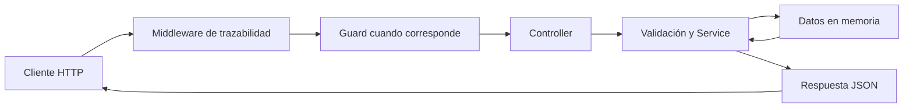
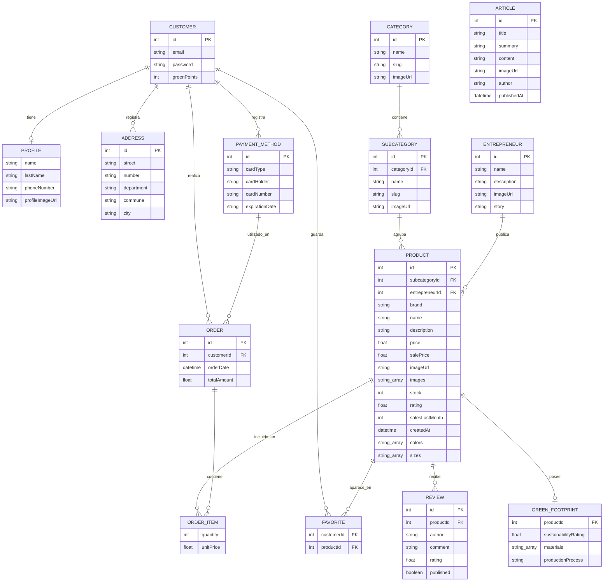

# BuenOrigen Backend


**API REST desarrollada con NestJS y TypeScript para la plataforma de comercio electrónico BuenOrigen.**

---

## Descripción

**BuenOrigen** es una plataforma orientada a la comercialización de productos sustentables de distintos emprendedores. Este repositorio contiene su backend, organizado mediante módulos, controladores, servicios y objetos de transferencia de datos (DTO).

La API permite consultar el catálogo, explorar categorías y subcategorías, obtener información de emprendedores y artículos, registrar clientes y administrar productos favoritos. Sus interfaces HTTP se documentan mediante Swagger / OpenAPI.

> **Estado de implementación:** se utilizan datos de prueba almacenados en memoria. Algunas comprobaciones de acceso funcionan mediante claves compartidas de prueba; no constituyen un sistema completo de autenticación, sesiones o autorización individual. Al reiniciar la aplicación, los cambios realizados sobre las colecciones en memoria no se conservan.

## Tecnologías

- Node.js, TypeScript y NestJS 11.
- Swagger / OpenAPI para documentación de la API.
- `class-validator` y `ValidationPipe` para validaciones de entrada.
- `@nestjs/config` para configuración por variables de entorno.
- Git para el control de versiones.

## Requisitos e instalación

Se requiere **Node.js**, **npm** y una terminal. Git es necesario para clonar el repositorio.

```bash
node -v
npm -v
git clone https://github.com/bootcamp-uchile-2026/grupo-2-backend.git
cd grupo-2-backend
npm install
```

También es posible obtener una copia mediante **Code → Download ZIP** desde GitHub y ejecutar `npm install` dentro de la carpeta extraída.

## Configuración local

El repositorio dispone de un archivo `.env.example` que sirve como plantilla de configuración. Crea un archivo `.env` local antes de iniciar la API:

```bash
# Git Bash
cp .env.example .env
```

```cmd
:: CMD de Windows
copy .env.example .env
```

Las variables conocidas son `PORT` (puerto HTTP; predeterminado `3000`), `ADMIN_API_KEY` y `CUSTOMER_API_KEY` (claves compartidas utilizadas por guards de prueba). Utiliza valores locales de desarrollo. **No publiques el archivo `.env` ni credenciales reales.** El archivo `.env.example` no debe contener secretos.

La aplicación carga esta configuración mediante `ConfigModule.forRoot({ isGlobal: true })` y accede a ella mediante `process.env`. No se incluye aquí un procedimiento de autenticación individual porque no está implementado como tal.

## Ejecución

**Desarrollo**, con recarga ante cambios:

```bash
npm run start:dev
```

**Compilación:**

```bash
npm run build
```

**Ejecución de la versión compilada:**

```bash
npm run start:prod
```

Con el puerto predeterminado, la API escucha en `http://localhost:3000`.

## Swagger / OpenAPI

Con la aplicación en ejecución:

- Interfaz Swagger: **http://localhost:3000/api**
- Especificación OpenAPI JSON: **http://localhost:3000/api-json**

Swagger describe las operaciones disponibles, parámetros, cuerpos de solicitud, DTO de respuesta y códigos HTTP. Para conocer los ejemplos y parámetros exactos de cada operación, consulta esta documentación interactiva.

## Arquitectura y módulos

La aplicación sigue la organización habitual de NestJS:

- **Controllers:** reciben las solicitudes HTTP, extraen parámetros y delegan en los servicios.
- **Services:** administran las colecciones en memoria, aplican las reglas y construyen las respuestas.
- **DTO:** establecen los contratos de entrada y salida, junto con sus validaciones y documentación.
- **Models:** representan las estructuras de datos del dominio.
- **Componentes comunes:** middleware de trazabilidad, interceptor, guards, errores personalizados y filtros de excepciones.

| Dominio | Organización y responsabilidad |
|---|---|
| **Customers** | Registro, consulta y actualización de clientes. |
| **Productos** | Búsqueda, ofertas, novedades, más vendidos, detalle, valoraciones, huella verde y productos relacionados. |
| **Categories** | Categorías y subcategorías, con controladores y servicios independientes dentro de `CategoriesModule`. |
| **Emprendedores** | Directorio, información pública y productos asociados a cada emprendedor. |
| **Artículos** | Listado y detalle de artículos del blog. |
| **Favoritos** | Consulta, incorporación y eliminación de productos favoritos de clientes. |

`ProductsService` mantiene la colección principal de productos; los servicios que necesitan esa información la reutilizan en lugar de mantener copias independientes. Los datos actuales se almacenan en arreglos en memoria.

### Flujo de una solicitud



Los pipes de validación y los filtros de excepciones intervienen en los puntos correspondientes del ciclo de vida de NestJS. Este esquema resume el recorrido general y no pretende representar todas las etapas internas del framework.

## Endpoints principales

Las rutas que utilizan parámetros de consulta o de ruta aparecen con ejemplos ilustrativos. **`buscar` es obligatorio en `GET /productos`; una solicitud sin ese parámetro responde HTTP 400.**

| Método | Ruta | Descripción |
|---|---|---|
| GET | `/productos?buscar=polera` | Buscar productos. |
| GET | `/productos/ofertas` | Productos en oferta. |
| GET | `/productos/mas-vendidos?cantidad=5` | Productos más vendidos. |
| GET | `/productos/nuevos` | Productos nuevos. |
| GET | `/productos/:productoId` | Detalle de un producto. |
| GET | `/productos/:productoId/huella-verde` | Huella verde del producto. |
| GET | `/productos/:productoId/valoraciones` | Valoraciones. |
| GET | `/productos/:productoId/relacionados` | Productos relacionados. |
| GET | `/categorias` | Listado de categorías. |
| GET | `/categorias/:categoriaId` | Detalle de categoría. |
| GET | `/categorias/:categoriaId/subcategorias` | Subcategorías de una categoría. |
| GET | `/subcategorias/:subcategoriaId/productos` | Productos de una subcategoría. |
| GET | `/subcategorias/:subcategoriaId/productos/populares` | Productos populares de una subcategoría. |
| GET | `/emprendedores?cantidad=2` | Listado de emprendedores. |
| GET | `/emprendedores/:emprendedorId` | Detalle de emprendedor. |
| GET | `/emprendedores/:emprendedorId/productos` | Productos del emprendedor. |
| GET | `/articulos` | Listado de artículos. |
| GET | `/articulos/:articleId` | Detalle de un artículo. |
| POST | `/customers` | Registro de cliente. |
| GET | `/customers` | Listado de clientes (acceso restringido de prueba). |
| GET | `/customers/:id` | Consulta de cliente (acceso restringido de prueba). |
| PATCH | `/customers/:id` | Actualización de cliente (acceso restringido de prueba). |
| GET | `/customers/:customerId/favoritos` | Listado de favoritos. |
| POST | `/customers/:customerId/favoritos` | Añadir favorito. |
| DELETE | `/customers/:customerId/favoritos/:productId` | Eliminar favorito. |

Los requisitos exactos de encabezados, cuerpos y respuestas se encuentran en Swagger. Algunos endpoints aplican guards mediante el encabezado `x-api-key` como mecanismo preliminar de control de acceso.

## Validaciones, errores y trazabilidad

El backend utiliza validaciones de DTO y una `ValidationPipe` global con `whitelist`, `forbidNonWhitelisted` y `transform`. Los servicios incorporan validaciones adicionales para reglas del dominio. Los errores personalizados se procesan mediante filtros comunes.

Entre las respuestas documentadas y verificadas se encuentran:

| HTTP | Uso |
|---|---|
| `200 OK` | Consulta exitosa. |
| `201 Created` | Creación exitosa. |
| `204 No Content` | Eliminación de favorito, sin cuerpo de respuesta. |
| `400 Bad Request` | Entrada o parámetro inválido. |
| `403 Forbidden` | Acceso denegado por un guard. |
| `404 Not Found` | Recurso inexistente. |
| `409 Conflict` | Conflicto como correo duplicado o favorito existente. |

La trazabilidad registra un identificador de solicitud (`x-request-id`), método, ruta, código HTTP, duración y fecha. Cuando corresponde, se registra el cuerpo de la petición con protección de datos sensibles, como contraseñas. **No deben incorporarse secretos a logs ni a ejemplos públicos.**

## Modelo de datos — diagrama entidad-relación de referencia

El diagrama siguiente representa **14 modelos TypeScript** definidos en `src/models`. Es una vista conceptual de sus asociaciones: no representa tablas SQL creadas ni claves foráneas impuestas por una base de datos. Algunas asociaciones se expresan mediante propiedades de tipo objeto o arreglos, sin campos de identificación explícitos en la clase.

`FAVORITE` relaciona clientes y productos mediante `customerId` y `productId`. `ARTICLE` no declara asociaciones directas con otros modelos. Los modelos de direcciones, métodos de pago y órdenes forman parte de la estructura del dominio, aunque no corresponden a módulos REST operativos en el código descrito.



## Docker

La aplicación BuenOrigen Backend puede ejecutarse dentro de un contenedor Docker. El proyecto incluye un `Dockerfile` que permite construir una imagen utilizando Node.js 22 sobre Alpine Linux.

El proceso de construcción utiliza dos etapas:

- **Construcción (`builder`):** instala las dependencias, copia el código fuente y compila la aplicación mediante `npm run build`.
- **Producción (`production`):** instala únicamente las dependencias de producción y copia los archivos compilados desde la etapa anterior.

### Requisitos

- Docker instalado y en ejecución.
- Acceso al repositorio del proyecto.
- Configuración necesaria para ejecutar la aplicación en el entorno correspondiente.

### Construir la imagen

Desde la raíz del repositorio, donde se encuentra el `Dockerfile`, ejecutar:

```bash
docker build -t buenorigen-backend:qa .
```

Este comando construye una imagen Docker denominada `buenorigen-backend` con la etiqueta `qa`.

Para comprobar que la imagen se creó correctamente:

```bash
docker images
```

### Ejecutar un contenedor

Para iniciar la aplicación a partir de la imagen construida, se puede utilizar el siguiente comando en un entorno donde el nombre del contenedor esté disponible:

```bash
docker run -d \
  --name buenorigen-qa \
  -p 3003:3000 \
  --env-file .env \
  buenorigen-backend:qa
```

El comando ejecuta la aplicación en segundo plano y establece la correspondencia entre el puerto `3003` del equipo anfitrión y el puerto `3000` del contenedor.

El archivo `.env` debe existir en el equipo donde se ejecuta Docker y contener la configuración requerida por la aplicación. No debe incorporarse al repositorio si contiene credenciales o información sensible.

**Importante:** el comando anterior es una referencia para crear un contenedor nuevo. Si ya existe un contenedor con el nombre `buenorigen-qa`, debe revisarse su estado antes de intentar crear otro.

### Verificar el contenedor

Consultar los contenedores en ejecución:

```bash
docker ps
```

Revisar los registros de la aplicación:

```bash
docker logs buenorigen-qa
```

Para comprobar el acceso local a Swagger, abrir:

http://localhost:3003/api

La disponibilidad de Swagger confirma que la aplicación responde en esa ruta.

---

## Despliegue en Oracle Cloud

El backend BuenOrigen se desplegó en una máquina virtual de Oracle Cloud con Ubuntu. Para ejecutar la aplicación se utilizó Docker, construyendo una imagen a partir del código del repositorio.

### Procedimiento de despliegue

1. **Acceso a la máquina virtual:** conexión remota mediante SSH utilizando la clave privada y las credenciales configuradas para la instancia.
2. **Acceso al repositorio:** ingreso al directorio del proyecto y utilización de la rama `qa`.
3. **Construcción de la imagen:** ejecución de `docker build` para generar la imagen `buenorigen-backend:qa`.
4. **Ejecución del contenedor:** inicio de la aplicación mediante Docker, publicando el puerto `3000` del contenedor en el puerto `3003` de la máquina virtual.
5. **Configuración de red:** habilitación del puerto `3003` en las reglas de ingreso de Oracle Cloud para permitir el acceso externo.
6. **Verificación:** comprobación de la respuesta HTTP de Swagger desde la máquina virtual y posterior acceso mediante la dirección pública.

### Imagen y contenedor de QA

| Elemento | Configuración |
|---|---|
| Plataforma | Oracle Cloud VM |
| Sistema operativo | Ubuntu |
| Rama utilizada | `qa` |
| Imagen Docker | `buenorigen-backend:qa` |
| Puerto del contenedor | `3000` |
| Puerto publicado en la VM | `3003` |
| Documentación Swagger | `/api` |

### Acceso a la aplicación

La documentación de la API se encuentra disponible en:

[Swagger — BuenOrigen QA](http://159.112.150.143:3003/api)

### Verificación del despliegue

Durante las pruebas se comprobó que el contenedor de QA se encontraba ejecutándose y que la ruta `/api` respondía con un código HTTP `200 OK` desde la máquina virtual. También se habilitó el puerto `3003` en Oracle Cloud y se confirmó el acceso externo a la aplicación.

Estas comprobaciones validan la ejecución del contenedor y la disponibilidad de Swagger.

### Consideraciones de seguridad

- No publicar claves privadas SSH, credenciales ni archivos `.env` con información sensible.
- Revisar las reglas de ingreso de Oracle Cloud y limitar el acceso al puerto publicado cuando corresponda.
- La URL documentada corresponde al ambiente QA


## Integración con aplicaciones cliente

Las aplicaciones cliente consumen la API mediante HTTP y reciben respuestas JSON. Los contratos de integración se describen en Swagger; los consumidores deben respetar los parámetros obligatorios, DTO y códigos de respuesta publicados.

## Documentación técnica

La documentación complementaria se encuentra en la [Wiki del repositorio](https://github.com/bootcamp-uchile-2026/grupo-2-backend/wiki). Para los contratos HTTP vigentes, se recomienda consultar también el Swagger generado directamente por la versión en ejecución.

## Equipo

Proyecto desarrollado por el equipo **BuenOrigen**, en el contexto del Bootcamp de Desarrollo Backend del DCC de la Universidad de Chile.
